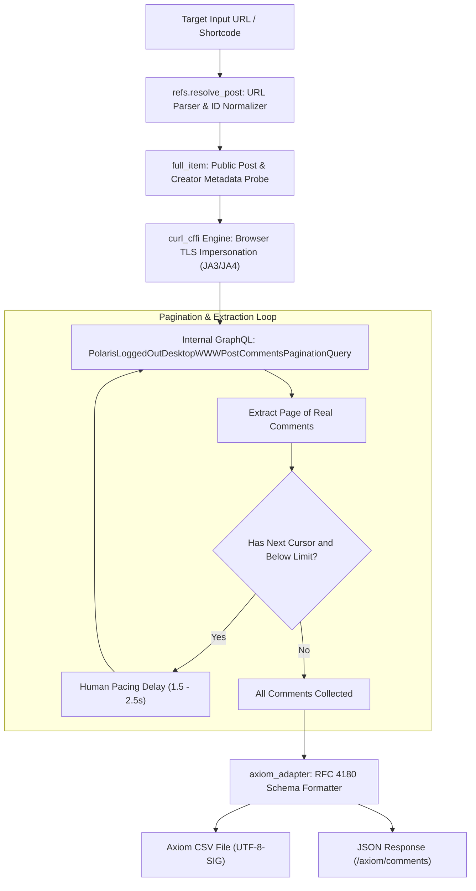

# 📸 AC-InstagramScraper

[](https://github.com/AcademyCity-RND/AC-InstagramScraper/actions/workflows/ci.yml)
[](https://github.com/AcademyCity-RND/AC-InstagramScraper/actions/workflows/audit.yml)
[](https://www.python.org/downloads/release/python-3110/)
[](https://datatracker.ietf.org/doc/html/rfc4180)
[](https://opensource.org/licenses/MIT)

**AC-InstagramScraper** is a high-performance, zero-authentication Instagram data and comment extraction engine maintained by **AcademyCity-RND**. Engineered for research, digital forensics, and OSINT workflows, it extracts rich public Instagram metadata and live comment threads without requiring user credentials, login prompts, or browser overhead.

---

## 📜 Attribution & Citation

This repository is a standardized fork and enhancement of the original open-source project:
- **Upstream Repository:** [omkarcloud/instagram-scraper](https://github.com/omkarcloud/instagram-scraper) by Omkar Cloud
- **Upstream License:** MIT License

### Enhancements Introduced in This Fork:
- **AXIOM Cyber Intelligence Pipeline Compatibility**: Standardized dataset export schema matching RFC 4180 CSV and JSON formats.
- **Python 3.11 Runtime Standardization**: Aligned container environment, packages, and type compatibility with the AXIOM backend stack.
- **Automated CI/CD & Security Auditing**: Full GitHub Actions test suites and automated vulnerability scanning via `pip-audit`.
- **Dependabot Integration**: Automated weekly dependency audits and security patch PRs.
- **Rate Pacing & Resilience**: Configurable cursor pagination with human delay intervals to mitigate velocity blocks.

---

## 🛠️ Tech Stack

| Category | Technology | Description |
| :--- | :--- | :--- |
| **Runtime** | `Python 3.11` | Core execution environment ensuring stability and type safety |
| **Network & TLS** | `curl_cffi` | Advanced browser TLS fingerprint impersonation (JA3/JA4) bypassing Cloudflare & Meta WAF |
| **Web Server** | `Bottle & Cheroot` | Microservice WSGI routing engine with high concurrency and low memory footprint |
| **Validation** | `Pydantic` | Data validation and structured schema transformation |
| **Testing & Quality** | `Pytest & Flake8` | Unit testing and syntax verification suite |
| **Security Audit** | `pip-audit` | Automated dependency vulnerability detection |
| **Containerization** | `Docker` | Multi-stage container packaging for portable deployment |
| **CI/CD** | `GitHub Actions` | Automated linting, unit testing, and weekly dependency management |

---

## 🔄 Workflow Architecture

The following diagram illustrates the complete data extraction and transformation pipeline from target URL input to structured dataset export:



---

## 🛡️ AXIOM Standard Dataset Schema

All comments processed through the AXIOM adapter (`instagram.axiom_adapter`) adhere strictly to the RFC 4180 standard schema:

| Column Name | Type | Description | Example |
| :--- | :--- | :--- | :--- |
| `comment_id` | `string` | Unique comment identifier | `18029384729102` |
| `created_at` | `string` | ISO 8601 UTC timestamp | `2026-11-08T14:30:00+00:00` |
| `author_username` | `string` | Comment author handle with `@` prefix | `@budi_santoso` |
| `author_display_name` | `string` | Display name or title-cased fallback | `Budi Santoso` |
| `raw_text` | `string` | Clean single-line comment body | `Kawal terus aspirasi rakyat secara damai!` |
| `likes_count` | `integer`| Total likes on the comment | `42` |
| `is_reply` | `boolean`| Whether the item is a reply to another comment | `False` |
| `target_context` | `string` | Context string with creator and caption snippet | `IG Creator: @kompascom \| Caption: Demo...` |

---

## 🚀 Quickstart Guide

### 1. Installation

```bash
# Clone the repository
git clone https://github.com/AcademyCity-RND/AC-InstagramScraper.git
cd AC-InstagramScraper

# Install core dependencies
pip install -r requirements.txt

# (Optional) Install development and testing dependencies
pip install -r requirements-dev.txt
```

### 2. Python SDK Usage (Direct Embedding)

```python
from instagram import fetch_comments_axiom, write_axiom_csv

# Extract real public comments live without login
target_url = "https://www.instagram.com/p/DfCR3JPlK9F/"
result = fetch_comments_axiom(target_url, max_comments=100)

print(f"Total extracted: {result['total_extracted']} comments")
print(f"Creator: {result['post_info'].get('owner_username')}")

# Save directly to RFC 4180 CSV
write_axiom_csv("output/dataset_axiom.csv", result["comments"])
```

### 3. Microservice API Server

```bash
# Start server (default port: 8000)
python run.py

# Query AXIOM-formatted comments
curl "http://localhost:8000/axiom/comments?url=https://www.instagram.com/p/DfCR3JPlK9F/&max=100"

# Healthcheck
curl "http://localhost:8000/health"
```

---

## 📚 Standard API Endpoints

The microservice serves both standard endpoints and `/axiom/*` intelligence endpoints:

| Endpoint | Method | Parameter | Description |
| :--- | :--- | :--- | :--- |
| `/axiom/comments` | `GET` | `url`, `max` | **AXIOM standardized live comments extraction** |
| `/posts/details` | `GET` | `post` | Complete metadata: caption, likes, creator, media URLs |
| `/posts/comments` | `GET` | `post`, `cursor` | Raw paginated comments directly from GraphQL |
| `/posts/media` | `GET` | `post` | Direct high-resolution image and video download renditions |
| `/users/profile` | `GET` | `user` | Profile bio, followers, counts, and category details |
| `/users/posts` | `GET` | `user`, `cursor` | User timeline posts (12 items per page) |
| `/users/reels` | `GET` | `user`, `cursor` | User Reels with view counts and audio IDs |
| `/hashtags/posts` | `GET` | `tag`, `cursor` | Top trending reels and posts for a given hashtag |
| `/search/keywords`| `GET` | `query`, `cursor`| Keyword-based topic search across Instagram |

---

## 🐳 Docker Deployment

Build and run the containerized service:

```bash
# Build the Docker image
docker build -t ac-instagram-scraper:1.0.0 .

# Run the container
docker run -d --name ac_scraper -p 8000:8000 ac-instagram-scraper:1.0.0

# Verify container status
curl http://localhost:8000/health
```

---

## 🧪 Testing

Run the automated test suite locally:

```bash
# Run pytest with verbosity
pytest -v

# Run security audit on dependencies
pip-audit -r requirements.txt
```

---

## ⚖️ License

Distributed under the **MIT License**. See `LICENSE` for details.
